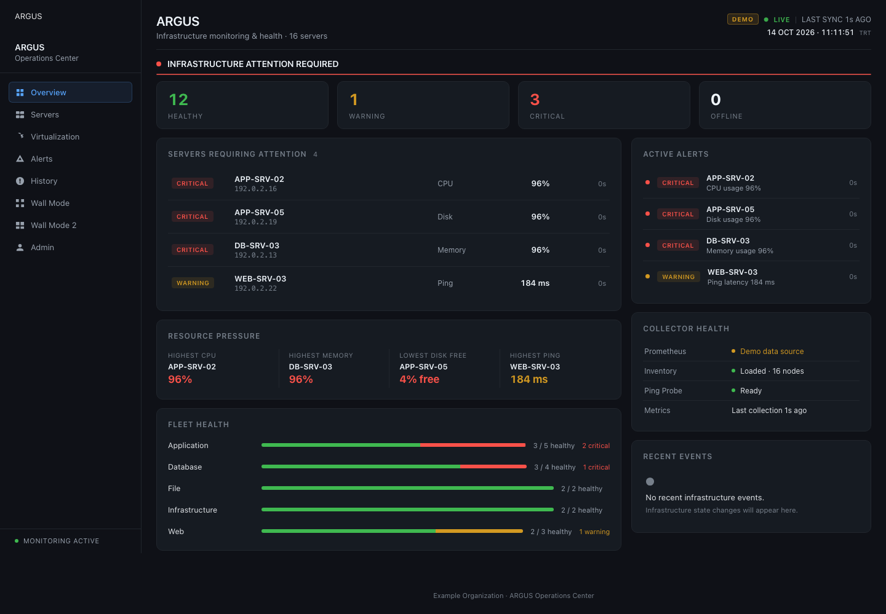
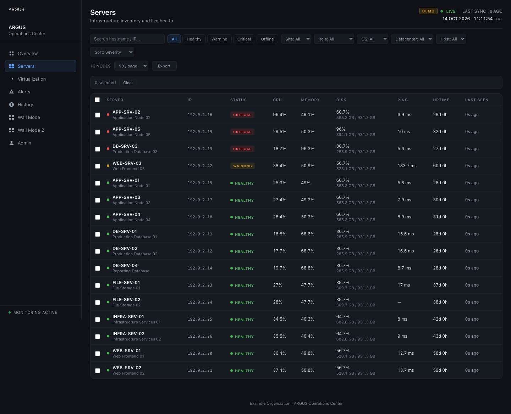
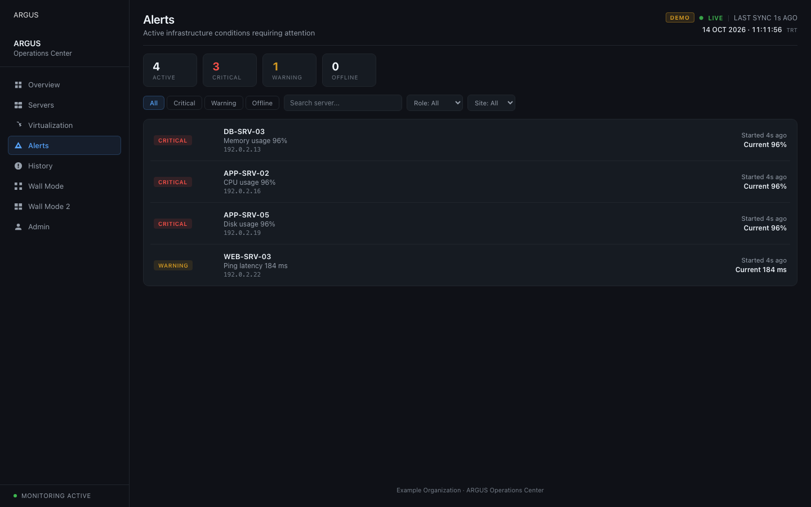

# ARGUS · Infrastructure Monitoring


ARGUS, sunucu durumunu ve kaynak kullanımını tek ekranda izlemek için geliştirilmiş bir Flask uygulamasıdır. Prometheus metriklerini okur; sunucu listesi, uyarılar, olay geçmişi, sanallaştırma görünümü ve e-posta bildirim yönetimi sunar.

Bu depo **paylaşım ve demo için temizlenmiş kaynak kodudur**. Gerçek sunucu envanteri, veritabanları, ölçüm geçmişi, parolalar, bağlantı bilgileri ve operasyon notları burada bulunmaz. Adresler örnektir.

## Özellikler

- Linux ve Windows exporter metrikleri ile ICMP erişilebilirlik takibi
- Eşiklere göre `HEALTHY`, `WARNING`, `CRITICAL`, `OFFLINE` ve `NO_TELEMETRY` durumları
- Sunucu listesi, ayrıntı görünümü, uyarılar ve SQLite olay geçmişi
- Sanallaştırma ağacı ve yönetim ekranı
- Bildirim kuralları, e-posta şablonları ve günlük rapor ayarları
- Gerçek altyapı gerektirmeyen demo modu

## Demo ekranları

Görüntüler `DEMO_MODE=true` ile üretilmiştir; gerçek altyapı verisi içermez.

### Genel görünüm



### Sunucular



### Uyarılar



## Yerel demo

Python 3.10 veya üzeri gerekir.

```bash
python3 -m venv venv
venv/bin/pip install -r requirements.txt
cp .env.example .env
venv/bin/python app.py
```

Ardından `http://127.0.0.1:8083` adresini açın. Örnek `.env` dosyasında `DEMO_MODE=true` ayarlıdır. `config/servers.yaml` boş olduğu için uygulama demo sunucularını üretir. Yönetici girişi için kullanıcı adı ve parola özeti ayrıca yapılandırılmalıdır.

Gerçek ortama geçerken `.env` içindeki `SECRET_KEY` için rastgele bir değer üretin; Prometheus, SMTP ve sunucu envanteri bilgilerini yalnızca kendi ortamınızda sağlayın. `.gitignore` çalışma sırasında oluşan `.env`, veritabanı ve hedef dosyalarını dışarıda tutar.

## Görseller

E-posta bildirimlerinde kullanılan logo dosyaları `static/img` altındadır:

| Banner | E-posta görseli | Küçük logo |
| --- | --- | --- |
|  |  |  |

## Teknoloji

Python, Flask, Jinja2, SQLite, Prometheus, vanilla JavaScript ve CSS.
